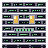

::: {.quest-dialog}
**Prerequisites:** Ground Truth. This is the boss at the end of the trunk. **Objective:** survive a wall of agent output without reading all of it and without trusting all of it.
**Time:** about 10 minutes. Each right answer on the first try damages the boss.

Practice guidance, not a vendor claim. Based on the habits taught in this zone.
:::

{.ao-boss-img fig-alt="Pixel-art portrait of the Wall of Output: a tall wall of terminal-style bricks filled with green scrolling text, with two glowing amber cursor eyes."}

## The Wall

The Wall is thousands of lines of generated diff (the list of lines a change added and removed), produced faster than anyone can review. If you merge it unread, the Blight spreads. If you try to read all of it, your attention thins and you approve things you did not understand. Both routes fail.

The way through is to **refuse it whole**: keep a **review budget** (only produce as much as you can honestly review today, because bulk low-quality output is called *slop*), ask for smaller pieces, ground each piece in a check, and pass on only work you have read yourself.

The AI for Science best practices (a European draft with no endorsements yet; practice 9) back this with a warning about the human check itself. Stating the human check is only the first step: oversight often fails through automation bias (trusting the machine's output too readily) and rubber-stamping (approving without reading). Their example is an "approve each item" step at hundreds of items an hour, which turns into clicking through. A check that works shows what changed, at a volume a person can read, with approve, edit, veto and stop. They also say to keep a real decision point wherever results or other people are affected, and to record the human step as part of the work's provenance. Not checked first-hand: read 2026-11-20 through a fetch summary, so re-check the wording on the page; see `research/aiforscience.md`.

## Battle: the Wall

::: {.ao-lore}
## Lore

*Further reading. Optional.*

- [AI for Science, practice 9: human-in-the-loop](https://aiforscience.eu/best-practices/09-human-in-the-loop/): AI for Science (European draft best practices), docs. Why read: it explains why a stated human check can still fail through rubber-stamping, and how to design one that works. A draft with no endorsements yet; some of its cases are uncited.
- [Best practices for Claude Code](https://code.claude.com/docs/en/best-practices): Anthropic, docs. Why read: it says to give the agent a check to run, so you can read one pass or fail line instead of the whole wall of output.
- [Effective context engineering for AI agents](https://www.anthropic.com/engineering/effective-context-engineering-for-ai-agents): Anthropic, article. Why read: it explains why more text in context is not free and why stale material hurts.
- [Lost in the Middle](https://arxiv.org/abs/2307.03172): arXiv, paper. Why read: it measures how accuracy drops when the relevant fact sits in the middle of a long input.
- [Explore the context window](https://code.claude.com/docs/en/context-window): Anthropic, docs. Why read: it shows what fills a Claude Code session and what survives compaction.
:::
